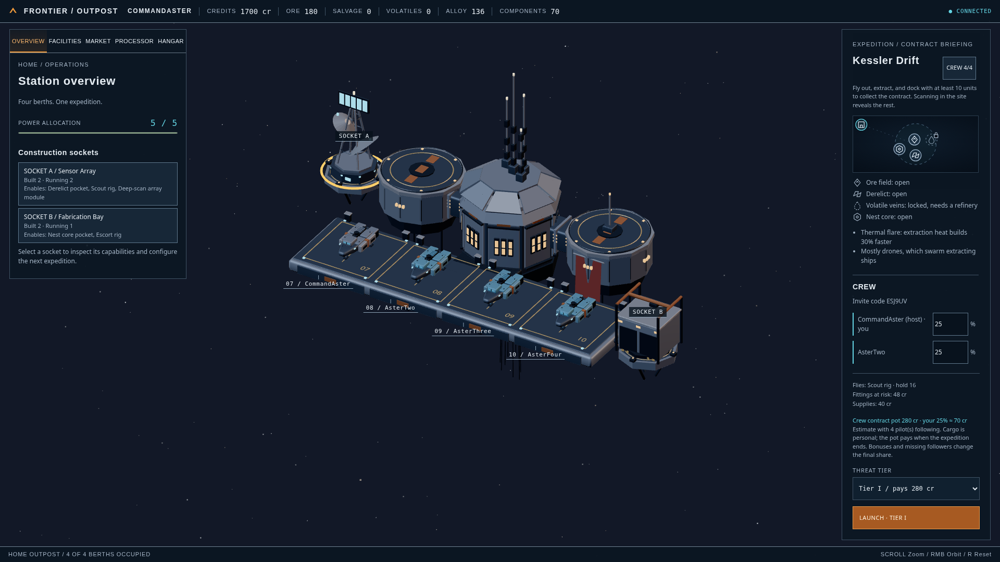

# Frontier Outpost — game scene foundation

Art direction: [Frontier Outpost Visual Style Guide](../Visual-Style-Guide.md). Game design: [Frontier Outpost](../FrontierOutpost.md).

A HUD-free outpost scene: an octagonal orbital depot with two circular side pods, a reinforced four-berth forward landing deck, a service spine, antenna mast and red pennant; faceted asteroids; a distant blue planet and procedural starfield.


## Files

- `FrontierOutpost.blend`: editable scene, overview camera and lighting, regenerated with Blender 4.3.0 when the ships moved to the art pipeline. `station.glb` keeps its four-berth bytes from Blender 4.3.2; the regenerated export differed only by float rounding in node rotations.
- `FrontierOutpostPreview.png`: rendered overview.
- `station.glb`, `asteroids.glb`: separate gameplay asset exports.
- The starter frigate and the Aurora cruiser have moved to [`Design/Art/hulls/`](../Art/README.md) (below).
- `create_scene.py`: deterministic source generator, seed 2266.
- `scene_manifest.json`: mesh statistics, scale and axis conventions.

## Rebuild

```sh
blender -b -t 8 --python create_scene.py
```

The script supports Blender 4.3+ and 5.x. This four-berth revision was generated and validated on Blender 4.3.2. The committed `.blend` and GLBs were generated with Blender 4.3; regenerating them on a newer Blender changes their bytes, not their geometry, so only commit regenerated binaries together with a reason. The script writes files alongside itself by default. Use `SCENE_OUTPUT` to choose a different directory, `RENDER_SAMPLES` to adjust quality, `RENDER_SCALE` for resolution percentage, or `SKIP_RENDER=1` to generate assets without rendering. No external textures, downloads or add-ons are required. Rendering uses Cycles, with denoising enabled only when the Blender build supports OpenImageDenoise.

## Game import

Use metres: Blender Z-up, ships forward +Y. The glTF exporter converts to glTF Y-up. `Station_ROOT` is the assembly pivot; child meshes remain separate for editing, destruction or interaction. The GLBs retain the scene's placement so they line up when imported together. Move each assembly root to the origin to use it as a standalone prefab. Asteroids are individually named mesh objects.

## Construction sockets and facility modules

Design section 10's starter outpost has two construction sockets. `Socket A` sits beside the cargo bay (the port pod, on the -X side) and `Socket B` beside berth 07. Each is a clamp platform: an octagonal deck 1.3 scene metres in radius, a yellow mounting guide, four clamps on the rim along the axes, struts and a bridge with a power conduit to the station. An empty named `Socket_A` or `Socket_B`, a child of `Station_ROOT`, marks the centre of each deck. A module's base goes there. The manifest records both anchors in station space.

The six original facility modules have moved to [`Design/Art/`](../Art/PIPELINE.md) through
M8's `split` command, one editable source and checked export per facility family. The game
loads their tiers through the generated art catalogue. They are no longer in the frozen scene
or its generator. Crew quarters is the first new facility authored through the same pipeline.

`SocketClosure_B*` meshes form a removable blanking plate and cross under the B anchor.
`Operating_Tier_1*` and `Operating_Tier_2*` meshes are service indicators on each facility.
The runtime importer preserves these nodes separately from static material batches so closed
and effective-tier states can change without replacing an owned module's silhouette. This
revision was regenerated with Blender 4.3.2; the added cover increases the station obstacle
check from 434 to 437 meshes while preserving the recorded four-berth clearances.

- **Sensor array.** Tier 1 is a plinth with a single dish on a mast. Tier 2 adds a lattice tower with two dishes and a phased array on top.
- **Refinery.** Tier 1 is two tanks, a manifold and a stack on a skid. Tier 2 has four tanks, a crusher hopper, twin stacks and a catwalk.
- **Fabrication bay.** Tier 1 is a hangar with one door and a crane arm. Tier 2 is a larger hangar with two doors, an overhead gantry and a robot arm.

## Ship classes and docking

The starter frigate and the Aurora cruiser moved to the art pipeline as `hulls/frigate/` and
`hulls/cruiser/` (`migrate_hulls.py`), with their original parts, modifiers and scale; this scene
and its generator no longer contain them. The pipeline checks that the frigate, a flown hull,
fits every berth in `berths.json` with 0.15 metres of clearance on every side; the cruiser is a
display hull, shown but never flown. The generator's own check of the landed frigate against
the station's solids along each departure corridor went with the frigate; the station and its
berths are frozen, and the berths give way to the internal hangar in M9.

The station's rear pad connector is flush with the bare deck at Z=0.83, leaving the landing area unobstructed.

GLBs use standard metal/roughness materials and emissive windows. The camera, planet, starfield, nebula, lights and translucent engine exhaust are presentation elements in the Blender file, excluded from the gameplay exports. Recreate bloom and exhaust in the target engine. The GLB exports contain no gameplay scripts, collision shapes or baked lightmaps.

This is an editable visual foundation, not a fully optimized production asset pack. Before shipping, combine repeated details or instance them, add collision meshes and LODs, atlas materials if needed, and profile against the target engine and hardware. Windows and small greebles intentionally remain separate for easy revision in the source. The game client supplies the HUD, controls, gear animation and runtime batching; the exports themselves contain no gameplay code.

## Scene organization

`Station`, `Asteroids`, `Backdrop`, `Lighting`, and `Cameras` collections isolate gameplay geometry from presentation. Materials are named by role. Geometry uses restrained bevels and flat-shaded rock facets to echo the reference's stylized industrial art direction.

## Four-berth station command upgrade

`berths.json` defines four slots (07–10), spaced 4 metres apart on a reinforced apron.
`Berth_07` through `Berth_10` are named empties in `station.glb`, with their bases on the
0.86-metre landing plane and their headings pointing outward. Socket B moves to the apron’s outer starboard edge, preserving its berth
adjacency bonus and clearing all departure lanes. The core gains segmented crown armor and
identification bands; the apron gains fascia, structural beams and service cabinets.

The generator checks that the berths clear the gameplay collision envelope and that the
sockets clear every departure lane.

The TypeScript client draws ships from the crew roster at server-assigned slots. The server
freezes slots for an active launch, so following out of order or another member leaving does
not reassign an occupied berth. Checkpoints preserve these assignments. Each pilot still owns
and manages their own home; roster ships do not introduce shared inventory or visiting-world
simulation. Home services are organized behind the Station Command HUD’s service navigation.

Static frigate armor is batched by material while landing gear remains independently animated.
Flight inputs use their own simulation-rate timer, so slow drawing does not interrupt thrust
or firing. The browser regression pauses drawing, flies, and reconnects to verify the server’s
position.



The runtime preview is a native browser capture from a granted local demonstration world,
not a Blender render or evidence of ordinary progression pacing. The current HUD uses the
measured clear scene area, forward berth labels and a pinned launch receipt. See
[the review implementation record](../Look-And-Feel-Implementation.md) for changes and validation.

## Frozen from plan M8

From plan M8 every new asset is authored in Blender through the art pipeline in
[`Design/Art/`](../Art/README.md), which also holds the Stage 1 expansion's art brief. This scene
is frozen: its assets stay until each is replaced there, and `create_scene.py` changes only to
remove what has moved.
