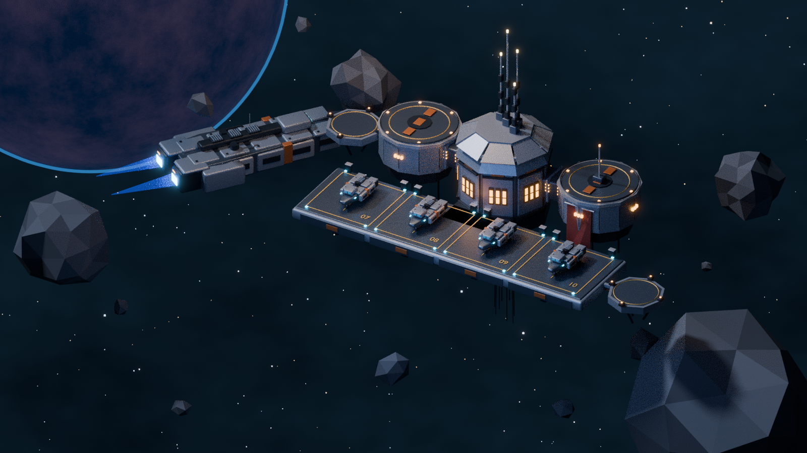
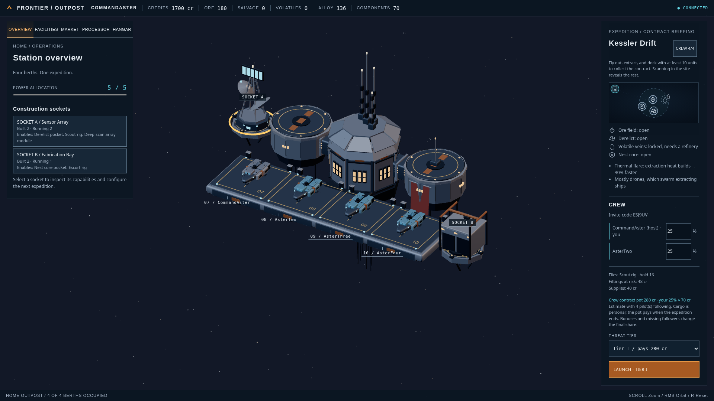

# Frontier Outpost — game scene foundation

Art direction: [Frontier Outpost Visual Style Guide](../Visual-Style-Guide.md). Game design: [Frontier Outpost](../FrontierOutpost.md).

A HUD-free outpost scene: an octagonal orbital depot with two circular side pods, a reinforced four-berth forward landing deck, a service spine, antenna mast and red pennant; the original Aurora ship preserved as a cruiser in the background; starter frigates demonstrating berths 07–10; faceted asteroids; a distant blue planet and procedural starfield.



## Files

- `FrontierOutpost.blend`: editable scene saved by Blender 4.3.2 for the four-berth upgrade, overview camera and lighting.
- `FrontierOutpostPreview.png`: rendered overview.
- `facilities.glb`: the three facility modules at two tiers each (plan item 5.1), exported apart from the station.
- `facilities_preview.png`: the six modules in a row, rendered from the facility catalogue camera.
- `starter_frigate_detail.png`: close-up of the starter frigate on its landing gear.
- `station.glb`, `cruiser.glb`, `frigate.glb`, `asteroids.glb`: separate gameplay asset exports. `station.glb` and `frigate.glb` were regenerated with Blender 4.3.2 for the four-berth upgrade; cruiser and asteroid exports retain their original bytes. `cruiser.glb` preserves the original Aurora hull at its original scale; `frigate.glb` is the new starter ship.
- `create_scene.py`: deterministic source generator, seed 2266.
- `scene_manifest.json`: mesh statistics, scale and axis conventions.

## Rebuild

```sh
blender -b -t 8 --python create_scene.py
```

The script supports Blender 4.3+ and 5.x. This four-berth revision was generated and validated on Blender 4.3.2. The committed `.blend` and GLBs were generated with Blender 4.3; regenerating them on a newer Blender changes their bytes, not their geometry, so only commit regenerated binaries together with a reason. The script writes files alongside itself by default. Use `SCENE_OUTPUT` to choose a different directory, `RENDER_SAMPLES` to adjust quality, `RENDER_SCALE` for resolution percentage, or `SKIP_RENDER=1` to generate assets without rendering. No external textures, downloads or add-ons are required. Rendering uses Cycles, with denoising enabled only when the Blender build supports OpenImageDenoise.

## Game import

Use metres: Blender Z-up, ships forward +Y. The glTF exporter converts to glTF Y-up. `Station_ROOT`, `Cruiser_ROOT`, and `Frigate_ROOT` are assembly pivots; child meshes remain separate for editing, destruction or interaction. The GLBs retain the scene's placement so they line up when imported together. Move each assembly root to the origin to use it as a standalone prefab. Asteroids are individually named mesh objects.

## Construction sockets and facility modules

Design section 10's starter outpost has two construction sockets. `Socket A` sits beside the cargo bay (the port pod, on the -X side) and `Socket B` beside berth 07. Each is a clamp platform: an octagonal deck 1.3 scene metres in radius, a yellow mounting guide, four clamps on the rim along the axes, struts and a bridge with a power conduit to the station. An empty named `Socket_A` or `Socket_B`, a child of `Station_ROOT`, marks the centre of each deck. A module's base goes there. The manifest records both anchors in station space.

`facilities.glb` holds six roots, `Facility_<facility>_T<tier>`, named by the game's facility identifiers (`sensor_array`, `refinery` and `fabrication_bay`) at tiers 1 and 2. Each root carries `facility` and `tier` custom properties. Each module is built around its root with its base at the root's origin. Its footprint stays within 1.25 scene metres of the centre on both horizontal axes, inside the rim clamps. Every tier 2 module stands more than 0.4 scene metres taller than its tier 1, so a tier change reads at the zoom where the whole outpost fits (design section 2). The generator asserts all three rules. In the Blender file the modules stand in a catalogue row out of the overview camera's frame. Move a root to a socket anchor (or its position to zero, under the anchor) to install it.

`SocketClosure_B*` meshes form a removable blanking plate and cross under the B anchor.
`Operating_Tier_1*` and `Operating_Tier_2*` meshes are service indicators on each facility.
The runtime importer preserves these nodes separately from static material batches so closed
and effective-tier states can change without replacing an owned module's silhouette. This
revision was regenerated with Blender 4.3.2; the added cover increases the station obstacle
check from 434 to 437 meshes while preserving the recorded four-berth clearances.

- **Sensor array.** Tier 1 is a plinth with a single dish on a mast. Tier 2 adds a lattice tower with two dishes and a phased array on top.
- **Refinery.** Tier 1 is two tanks, a manifold and a stack on a skid. Tier 2 has four tanks, a crusher hopper, twin stacks and a catwalk.
- **Fabrication bay.** Tier 1 is a hangar with one door and a crane arm. Tier 2 is a larger hangar with two doors, an overhead gantry and a robot arm.

## Ship classes and docking

Aurora is now a cruiser: its original hull, armor, equipment, materials and scale are retained, with a new background position. Its blue engine spill lights follow its assembly root. The starter frigate is a separate, simpler design with the same split armor, orange band and twin drive layout. It has a compact bridge, one small defense mount and deployed tripod landing gear. Its engines idle while landed.

[See the starter frigate close-up](starter_frigate_detail.png). The Blender file also includes a detail camera for inspecting the new ship.

The frigate is aligned with the pad's longitudinal axis. The generator measures its complete evaluated geometry, including bevels and landing feet, in station coordinates and checks that it stays at least 0.15 scene metres inside the painted safety perimeter. The feet are placed at station-local Z=0.86 to clear the deck's raised painted markings. Measurements are recorded in `scene_manifest.json` under `docking_validation`. Exhaust is off and excluded from the landed frigate's footprint. This validates geometric fit; docking gameplay and animations still need implementation in the game engine.

The station's rear pad connector is flush with the bare deck at Z=0.83, leaving the landing area unobstructed. The generator also checks the complete frigate bounds against every structural station mesh; decorative paint overlays are excluded from this overlap check.

GLBs use standard metal/roughness materials and emissive windows. The camera, planet, starfield, nebula, lights and translucent engine exhaust are presentation elements in the Blender file, excluded from the gameplay exports. Recreate bloom and exhaust in the target engine. The GLB exports contain no gameplay scripts, collision shapes or baked lightmaps.

This is an editable visual foundation, not a fully optimized production asset pack. Before shipping, combine repeated details or instance them, add collision meshes and LODs, atlas materials if needed, and profile against the target engine and hardware. Windows and small greebles intentionally remain separate for easy revision in the source. The game client supplies the HUD, controls, gear animation and runtime batching; the exports themselves contain no gameplay code.

## Scene organization

`Station`, `Cruiser`, `Frigate`, `Asteroids`, `Backdrop`, `Lighting`, and `Cameras` collections isolate gameplay geometry from presentation. Materials are named by role. Geometry uses restrained bevels and flat-shaded rock facets to echo the reference's stylized industrial art direction.

## Four-berth station command upgrade

`berths.json` defines four slots (07–10), spaced 4 metres apart on a reinforced apron.
`Berth_07` through `Berth_10` are named empties in `station.glb`, with their bases on the
0.86-metre landing plane and their headings pointing outward. The frigate stays at its
established scale. Socket B moves to the apron’s outer starboard edge, preserving its berth
adjacency bonus and clearing all departure lanes. The core gains segmented crown armor and
identification bands; the apron gains fascia, structural beams and service cabinets.

The generator checks the evaluated frigate in every berth, all station solids along each
straight departure corridor, the gameplay collision envelope, inter-ship clearance and socket
clearance. The manifest records the four individual results. The Blender overview includes
three linked presentation copies of the frigate; these are excluded from the gameplay exports.

The TypeScript client draws ships from the crew roster at server-assigned slots. The server
freezes slots for an active launch, so following out of order or another member leaving does
not reassign an occupied berth. Checkpoints preserve these assignments. Each pilot still owns
and manages their own home; roster ships do not introduce shared inventory or visiting-world
simulation. Home services are organized behind the Station Command HUD’s service navigation.

Static frigate armor is batched by material while landing gear remains independently animated.
Flight inputs use their own simulation-rate timer, so slow drawing does not interrupt thrust
or firing. The browser regression pauses drawing, flies, and reconnects to verify the server’s
position.



The runtime preview is a native browser capture from a granted local demonstration world,
not a Blender render or evidence of ordinary progression pacing. The current HUD uses the
measured clear scene area, forward berth labels and a pinned launch receipt. See
[the review implementation record](../Look-And-Feel-Implementation.md) for changes and validation.

## Stage 1 expansion art brief

What the Blender work must add for the Stage 1 expansion (design §11, plan M8 to M12). Each
milestone's Blender work item (8.1, 9.2, 9.3, 10.1, 11.1, 12.1) builds its part of this brief. The owner runs
Blender; the agents' environment has none. Everything below follows the conventions above and
style guide §2 to §9; where this brief adds a convention, the style guide records it too.

### Working rules for every addition

- Blender 4.3+ and 5.x, metres, Z-up, ships forward +Y, as above.
- **Leave the existing assets unchanged.** The generator draws from one seeded random stream
  (`random.seed(2266)`), so new geometry either draws nothing or is added after every existing
  draw, or uses its own `random.Random` instance. Run with `SCENE_OUTPUT` outside the repo and
  diff the manifest: existing entries may only gain fields.
- **Every rule below is asserted by the generator** and its result written to
  `scene_manifest.json`, as the socket and facility rules already are. A rule that is not
  asserted is not met.
- Budgets, as reference figures (style guide §9): a facility module at most about 6,000 base-mesh
  triangles, a hull at most about 6,000.
- Nodes the game toggles at runtime stay separate meshes with stable names, like
  `SocketClosure_B*` and `Operating_Tier_*` today.
- These rules are for `create_scene.py`. The station's exterior is the owner's own model and has
  its own rules and check script (below).

### The station's exterior (9.2): the owner's model

From M9 the station is seen two ways (design §11): an **exterior** with no sockets, modules or
parked ships, and an **interior** cutaway with them. The exterior is the owner's hand-made Blender
model; it is the one asset not generated by `create_scene.py` (AGENTS.md §6, §8). It lives in its
own scene folder, `Design/StationExterior/`, with the files style guide §8 lists, except that its
`.blend` is the hand-made source and a check script stands in for the generator. Until M9, the
four-berth station above and its checks stand.

The check script, `check_exterior.py`, runs in Blender on the owner's file and fails on any rule
below. It exports `station_exterior.glb` and writes `exterior_manifest.json`, which the game
reads; the three are committed together after every change.

- **Units, axes and root:** metres, Z-up, a `StationExterior_ROOT` pivot at the dock point, the
  hangar mouth facing station-space +Y.
- **Scale:** two to three times today's station, the factor chosen in the greybox first (9.1).
  Ships keep their size.
- **One hangar mouth,** marked by an empty named `Hangar_Mouth` at the centre of its opening on
  the landing plane, facing out along the approach. Its clear opening is at least 6 m wide and
  3 m high (placeholders), and wider and taller than the largest hull in the generated manifest
  with 0.15 m on every side, so crew ships can leave one after another.
- **A clear approach lane:** a straight corridor out of the mouth, as wide as the opening and at
  least 30 m long, free of every exterior mesh and of every tell at its largest.
- **Tell hardpoints:** one empty per facility, named `Tell_<facility>` with the game's facility
  identifiers, and one named `Tell_reactor`, each on the hull's surface, visible from the resting
  tactical camera, and at least 1.5 m from the approach lane, so a tell at its largest clears it.
- **No sockets, modules, berths or ships** in the exterior: those are the interior's.
- **Readable from the tactical view.** Style guide §1 and §2 still hold: a strong central mass and
  restrained detail. Tall spires or dense lit detail that work in a perspective hero shot become
  clutter at 33° orthographic and hide ships; the greybox block (9.1) decides how tall the
  station may stand.
- **Budget:** about 30,000 base-mesh triangles as a reference figure (style guide §9); materials
  are standard metallic/roughness, with emissive windows.

### The station's interior and the tells (9.3)

The interior is a cutaway of the station, generated by `create_scene.py`, seen through the same
orthographic camera as everything else (AGENTS.md §4.5): open to the resting view, so every
socket and the hangar deck can be read without orbiting.

- **Its parts:** the hangar deck with one parking place per hull the game has (frigate, hauler,
  gunship), sockets A, B and C with C blanked (`SocketClosure_C*`) until the reactor is bought,
  the processor (a hopper, a furnace drum and an output chute; design §10 names it, but no scene
  models it yet) and the cargo bay. Socket A sits beside the cargo bay and socket B beside the
  hangar deck, so their adjacency rules still describe the place.
- **Anchors:** an empty per socket (`Socket_A`, `Socket_B`, `Socket_C`) and per parking place
  (`Parking_<hull>`), recorded in the manifest, as the socket anchors are today.
- **Nothing hides anything:** from the resting camera no wall, module or parked ship covers
  another socket or parking place. The generator checks each socket's and parking place's bounds
  against the others along the resting view direction.
- **Exterior tells**, exported to `tells.glb`: a small marker per facility per tier, named
  `Tell_<facility>_T<tier>`, plus `Tell_reactor`, each in the facility's signature shape (below)
  and within a 1.5 m cube at its largest. The game sets each on its hardpoint on the owner's
  exterior. Each tier's tell reads as bigger than the last.

### Facility modules (8.1, 9.3, 10.1, 11.1, 12.1)

Every new module follows the existing module rules: a root named `Facility_<facility>_T<tier>`
with `facility` and `tier` properties, its base at the root's origin, its footprint within
1.25 m of the centre on both horizontal axes (times the interior's scale, from 9.3), nothing below its base, `Operating_Tier_<n>`
indicators for each tier it has, and a slot in the catalogue row out of the overview camera's
frame. Identifiers match the game's facility data.

| Module | Root names | Tier 1 | Tier 2 | Tier 3 |
|---|---|---|---|---|
| Crew quarters (8.1) | `Facility_crew_quarters_T1`, `_T2` | A pressurised habitat: two horizontal cylinders with warm windows and an airlock | A second deck and an observation dome; a small davit for the wingman's shuttle | None |
| Shipyard (11.1) | `Facility_shipyard_T1`, `_T2` | An open lattice cradle holding a hull frame, with a gantry over it | Two cradles, a longer gantry and fuel-cell racks | None |
| Navigation array (12.1) | `Facility_navigation_array_T1`, `_T2` | A transmitter spire ringed by beacon lamps, with a star-tracker tube | Twin rings round the spire and a longer telescope | None |
| Sensor array (10.1) | `Facility_sensor_array_T3` | As built | As built | A large radome on the tier 2 lattice |
| Refinery (10.1) | `Facility_refinery_T3` | As built | As built | A fuel-cell plant: pressure spheres and a cracking column beside the tier 2 tanks |
| Fabrication bay (10.1) | `Facility_fabrication_bay_T3` | As built | As built | A plate press and stacked armour plates outside a larger hall, with a second gantry |

Rules the generator asserts, besides the existing ones:

- **Each tier reads as bigger:** every tier 2 stands more than 0.4 m taller than its tier 1, and
  every tier 3 more than 0.4 m taller than its tier 2.
- **Each facility has its own signature shape**, so it is told apart at the zoom where the whole
  outpost fits. The shipyard is an open cradle, never a closed hall: the fabrication bay is the
  hall with doors. The navigation array has no dishes: the sensor array is the dishes.
- **A module installed in any socket fits the station.** With each module set on each socket
  anchor, its evaluated bounds clear every berth's safety boundary and departure corridor while
  the sockets are outside (before 9.3), and fit inside the interior without covering another
  socket or parking place from the resting camera after. This is new: today's tallest module
  stands 4.5 m, and tier 3 is taller.
- **Each facility's tell** (9.3) uses the same signature shape as its module, so a facility is
  recognised outside and in.

### Socket C and the reactor (10.1)

- **Socket C** is already in the interior from 9.3, beside the processor, blanked by
  `SocketClosure_C*`; 10.1 makes everything it needs to open when the reactor is bought, and the
  three tier 3 modules and tells.
- **The reactor upgrade** sits in the interior's core, in meshes named `Reactor_Upgrade*`, shown
  only once it is bought, and does not cover a socket or parking place from the resting camera.
  Outside, its tell `Tell_reactor` appears on the owner's hardpoint.

### Hulls (11.1)

The hauler and the gunship join the starter frigate's family (style guide §3): split dorsal
armour, a central service spine, orange bands, dark inset panels and twin drive pods, with
proportions and equipment changed for the role. Neither may read as a hostile: allegiance is
told by shape as well as colour, and hostiles are forked silhouettes.

| Hull | Root | Silhouette | Size |
|---|---|---|---|
| Hauler | `Hauler_ROOT` | Wide and boxy: two cargo pods slung either side of the spine, a short bridge, no visible guns | Noticeably wider than the frigate |
| Gunship | `Gunship_ROOT` | About the frigate's length, with forward weapon mounts, a turret on the spine and a shield emitter ring | No larger than needed |

- **Every hull passes through the hangar mouth** flying straight in along the approach lane, with
  0.15 m clearance on every side (style guide §4), including weapons and attachments. The
  generator records each hull's bounds, and the exterior's check script tests the mouth against
  the largest.
- **Every hull has its parking place** on the interior's hangar deck (`Parking_<hull>`), which it
  fits with the same clearance, without covering another from the resting camera.
- **No landing gear is needed.** Ships are never drawn landed once the berths are gone. The
  starter frigate keeps its gear until 9.6 removes the landed presentation.
- **The collision radius comes from the model.** The manifest records each hull's footprint
  radius about its root; the game's hull data (11.2) takes its collision radius from it, so the
  drawn hull is as large as the ship the server collides.
- **Exports:** one GLB per hull (`hauler.glb`, `gunship.glb`), each root at its own origin's
  placement as the frigate is, with no gameplay scripts or collision shapes.

### Not in this brief

The sentinel and the stalker (12.3) are drawn by the client's readability rules, as every hostile
is today; no hostile has a Blender model yet. The site map and the new sites' scenery are client
and data work.
