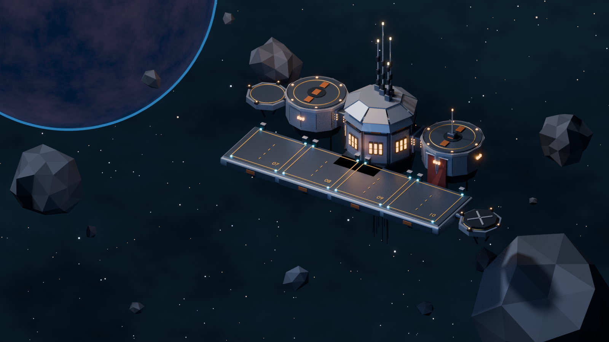

# Frontier Outpost — game scene foundation

Art direction: [Frontier Outpost Visual Style Guide](../Visual-Style-Guide.md). Game design: [Frontier Outpost](../FrontierOutpost.md).

What remains of the generated scene: faceted asteroids, a distant blue planet, a procedural
starfield and the scene's lighting. Everything else it once held has moved to the art pipeline
in [`Design/Art/`](../Art/README.md):

| Asset | Now |
| --- | --- |
| The six facility modules | `Design/Art/facilities/` (plan M8.3) |
| The starter frigate and the Aurora cruiser | `Design/Art/hulls/frigate/` and `hulls/cruiser/` (`migrate_hulls.py`) |
| The four-berth station, its sockets and its berths | `Design/Art/station/exterior/` and `station/interior/` (plan M9); the berths are gone |

The rules own the new station's gameplay geometry (`crates/sim/src/station.rs`: the mouth, the
approach lane and the footprint); the art pipeline checks the exterior against it. Earlier
revisions of this scene, with the station and its four berths, are in Git history.



## Files

- `FrontierOutpost.blend`: editable scene, overview camera and lighting, regenerated with
  Blender 4.3.0 when the station moved to the art pipeline.
- `FrontierOutpostPreview.png`: rendered overview.
- `asteroids.glb`: the asteroids, a gameplay export, unchanged in bytes by the moves above.
- `create_scene.py`: deterministic source generator, seed 2266.
- `scene_manifest.json`: mesh statistics, scale and axis conventions.

## Rebuild

```sh
blender -b -t 8 --python create_scene.py
```

The script supports Blender 4.3+ and 5.x. Regenerating on a newer Blender changes bytes, not
geometry, so only commit regenerated binaries together with a reason. The script writes files
alongside itself by default. Use `SCENE_OUTPUT` to choose a different directory,
`RENDER_SAMPLES` to adjust quality, `RENDER_SCALE` for resolution percentage, or
`SKIP_RENDER=1` to generate assets without rendering. No external textures, downloads or
add-ons are required.

The removed station drew 14 numbers from the seeded random stream before the asteroids were
made; the generator still draws them, so every asteroid keeps its shape.

## Game import

Use metres: Blender Z-up, forward +Y. The glTF exporter converts to glTF Y-up. Asteroids are
individually named mesh objects and keep the scene's placement.

## Scene organization

`Asteroids`, `Backdrop`, `Lighting` and `Cameras` collections isolate gameplay geometry from
presentation. The planet, starfield, nebula and lights are presentation only and are excluded
from the export.

## Frozen from plan M8

From plan M8 every new asset is authored in Blender through the art pipeline in
[`Design/Art/`](../Art/README.md), which also holds the Stage 1 expansion's art brief. This scene
is frozen: its assets stay until each is replaced there, and `create_scene.py` changes only to
remove what has moved.
