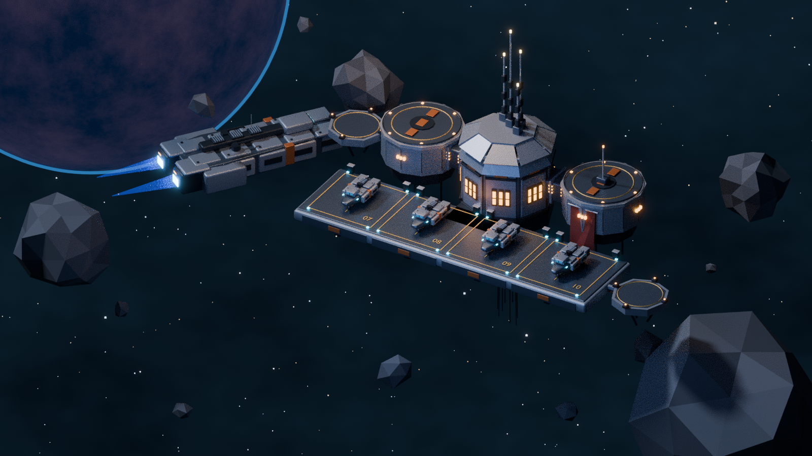

# Frontier Outpost

Establish and enhance your outpost. Equip ships for dangerous expeditions, bring discoveries home,
and expand the facilities that determine what you can build and where you can go.

Frontier Outpost is a multiplayer isometric space game for solo players and crews of 1–4. It has an
authoritative Rust server and an HTML5 client built with TypeScript and Three.js.



## Status

Pre-production. The repository holds the game design, the visual style guide, a reference Blender
scene, and a minimal code skeleton with CI. No gameplay is implemented yet.

## Documents

- [Game design](Design/FrontierOutpost.md)
- [Stage 1 implementation plan](Design/Stage1-Plan.md)
- [Visual style guide](Design/Visual-Style-Guide.md)
- [Outpost scene](Design/FrontierOutpost/README.md)
- [Contributor and agent guide](AGENTS.md): layout, commands, architecture rules, code standards

## Getting started

Prerequisites: [rustup](https://rustup.rs/) (it installs the pinned toolchain), Node.js 26
(see `client/.nvmrc`), [Git LFS](https://git-lfs.com/), and Blender 4.3+ for scene work.

```sh
git lfs install
git clone https://github.com/Zwaliebaba/FrontierOutpost.git
cd FrontierOutpost

cargo test --workspace
cargo run -p frontier-server

cd client
npm ci
npm run dev
```

## Licence

All rights reserved. See [LICENSE](LICENSE).
